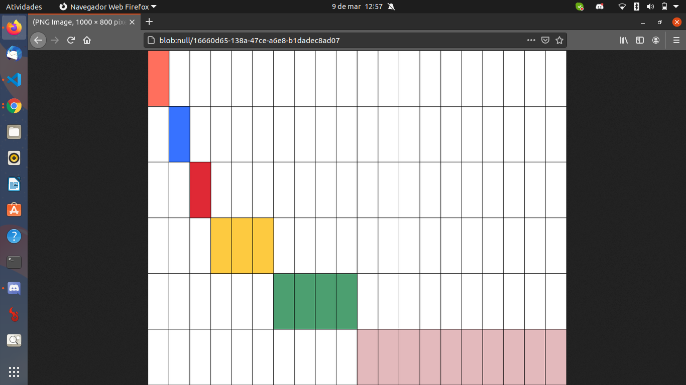

<p align="center">
  
</p>

<p align="center">
  
  
  
</p>

## Sobre o Projeto

Visualizador gráfico em **JavaScript + p5.js** para simular e ilustrar o algoritmo de escalonamento de CPU **Shortest Job First (SJF)**, exibindo a linha do tempo de execução dos processos divididos por *quantum* em um canvas colorido.

<p align="center">
  
</p>

## Estrutura do Repositório

```text
Shortest-Job-First/
├── Shortest_Job_First.png     # Captura da visualização do escalonamento
├── projeto_base/              # Versão base do visualizador (p5.js)
│   ├── index.html
│   ├── sketch.js
│   ├── input.txt
│   └── libraries/
└── projeto_base_alterado/     # Versão modificada com implementação SJF
    ├── index.html
    ├── sketch.js
    ├── input.txt
    └── libraries/
```

## Como Executar

1. Clone o repositório:
   ```bash
   git clone https://github.com/charles-gabriel-cc/Shortest-Job-First.git
   ```
2. Abra `projeto_base_alterado/index.html` (ou `projeto_base/index.html`) diretamente no navegador — ou sirva com um servidor estático local:
   ```bash
   npx serve projeto_base_alterado
   ```
